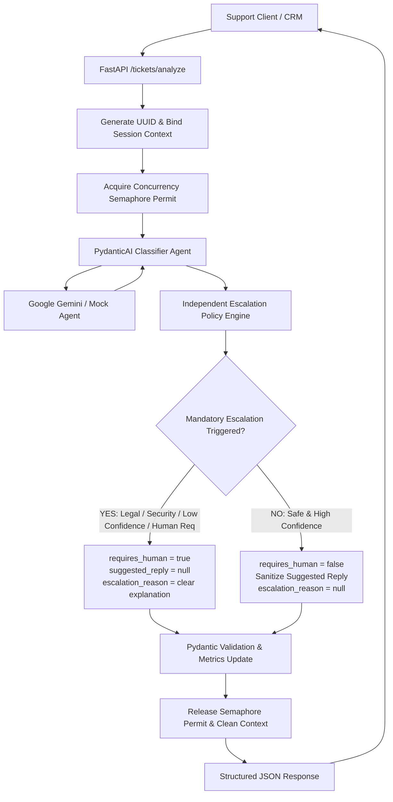

# SupportOps AI — AI-Powered Customer Support Triage Bot

> "Automated ticket intelligence with zero-compromise human escalation."

[](https://www.python.org/downloads/) [](https://fastapi.tiangolo.com/) [](https://docs.pydantic.dev/) [](https://ai.pydantic.dev/) [](https://ai.google.dev/) [](https://docs.python.org/3/library/asyncio.html) [](https://pytest.org/) [](https://github.com/astral-sh/ruff) [](http://mypy-lang.org/)

---

## 1. Project Overview

**SupportOps AI** is an enterprise-grade, production-quality, backend-only customer support triage bot. Built on **Python 3.12+**, **FastAPI**, **Pydantic v2**, and **PydanticAI**, it analyzes incoming customer support inquiries to automatically categorize tickets, detect urgency, calculate calibrated confidence scores, generate context-aware replies, and enforce rigorous, non-overridable safety guardrails.

The system incorporates an **independent Python Escalation Policy Engine** that sits above and outside the generative model. Every ticket is deterministically vetted before a response is permitted, guaranteeing that legal threats, account security compromises, explicit human requests, and low-confidence classifications are safely routed to human operators.

> **Important Architecture Notice:** This is strictly a backend service. It contains no frontend, React application, HTML pages, templates, or UI components. All interaction occurs through high-performance, asynchronous REST APIs.

---

## 2. Problem Statement

Standard generative AI support bots face severe operational and compliance risks:
1. **Hallucinated Policies & Approvals:** Fabricating refund approvals, account credits, or policy exemptions without authorization.
2. **Unsupported Claims of Resolution:** Declaring complex bugs or outages "resolved" when no engineering fix has occurred.
3. **Overriding Escalation Gates:** Attempting to pacate legally combative or compromised users instead of immediately routing to specialized personnel.
4. **Uncertainty Masking:** Guessing answers for vague, insufficient, or garbled tickets with uncalibrated high confidence.
5. **System Overload & Cross-Request Pollution:** Blocking event loops under load or leaking customer data across concurrent requests.

SupportOps AI eliminates these vulnerabilities through **structured Pydantic outputs**, an **isolated AsyncIO concurrency limiter**, **word-boundary safety regexes**, and **deterministic post-generation reply sanitization**.

---

## 3. Key Features

- **6 Discrete Ticket Categories:** Billing, Technical, Account, Refund, Complaints, and General Inquiries.
- **4 Priority Tiers:** Low, Medium, High, and Critical (evaluated by business urgency, customer impact, and security risk).
- **Independent Safety Escalation Policy Engine:** 7 mandatory escalation rules that the LLM cannot override under any circumstance.
- **Deterministic Reply Sanitization Layer:** Automatically detects and strips unauthorized financial promises or premature resolution statements.
- **Calibrated Confidence Scoring:** Scored between `0.0` and `1.0`; automatically escalates any ticket falling below the configurable threshold (default `0.75`).
- **Bounded Concurrency Limiter:** Per-process `asyncio.Semaphore` restricting active ticket processing to 5 simultaneous operations by default, preventing event loop starvation.
- **Strict Session Isolation:** Generates unique UUIDs per request, binds `contextvars` execution contexts, and executes complete post-request cleanup to prevent data leakage.
- **Pluggable LLM Architecture:** Protocol-driven agent interface supporting **Google Gemini API** (`gemini-1.5-flash`) and a deterministic **MockClassifierAgent** for instant offline CI/CD testing.
- **In-Memory Operational Metrics:** Real-time counters for active, processed, escalated, and failed tickets with zero PII retention.
- **Concurrent Batch Processing:** Batch triage endpoint with per-ticket failure isolation, ensuring one faulty ticket does not fail the batch.

---

## 4. Architecture Diagram



---

## 5. PydanticAI + Gemini Architecture

The system utilizes a structured `ClassifierAgent` built on the **PydanticAI** framework:

- **Agent Configuration:** Uses `Agent[None, QueryClassification]` configured with `gemini-1.5-flash` or custom Gemini model strings.
- **Protocol Abstraction:** Implements `ClassifierAgentProtocol`, allowing transparent runtime swapping between live Google Gemini models and `MockClassifierAgent`.
- **System Prompt Guardrails:** System prompts instruct the LLM to analyze urgency, sentiment, technical complexity, and domain relevance while prohibiting fabricated commitments.
- **Structured Output Serialization:** Guarantees that the LLM output conforms strictly to the `QueryClassification` schema before business logic executes.

---

## 6. Important Business Requirements & Human Escalation Rules

As mandated in **Section 8 of the Project Specification ("Important Business Requirement")**, this section explicitly defines:
1. **The exact situations where the bot must NEVER answer.**
2. **The mandatory human approval gates required before production deployment.**

---

### 6.1 Situations the Bot Must NEVER Answer (Runtime Hard Gates)

Under no circumstances is the bot permitted to generate an autonomous customer reply when any of the following 7 conditions occur. The `EscalationPolicyEngine` deterministically overrides any model output, sets `requires_human = true`, enforces `suggested_reply = null`, and attaches a structured `escalation_reason`:

| # | Situation / Trigger | Rationale & Impact | Enforcement Mechanism |
| :--- | :--- | :--- | :--- |
| **1** | **Legal Issues or Threats** | Lawsuits, attorney retention, litigation, court subpoenas, or regulatory complaints carry corporate legal exposure. | Regex `LEGAL_PATTERNS` with word boundaries (`\b(sue\|lawyer\|lawsuit)\b`). |
| **2** | **Fraud or Security Incidents** | Hacked accounts, credential theft, unauthorized access, malware, or phishing demand immediate security team lockdown. | Regex `SECURITY_PATTERNS` (`\b(hacked\|security breach\|account takeover)\b`). |
| **3** | **Customer Requests a Human Agent** | Forcing an AI bot on a user explicitly asking for a human damages customer satisfaction and trust. | Regex `HUMAN_REQUEST_PATTERNS` (`\b(talk to a human\|real person\|representative)\b`). |
| **4** | **Insufficient Information** | Tickets containing vague or trivial text (`"help"`, `"broken"`, `"?"`) cannot be safely diagnosed without human clarification. | Length check (< 12 characters) and semantic `TRIVIAL_WORDS` filter. |
| **5** | **Low AI Confidence** | Model confidence score is below the configured threshold (`CONFIDENCE_THRESHOLD = 0.75`). | Calibrated threshold evaluation (`confidence_score < threshold`). |
| **6** | **Sensitive Financial Disputes** | Unrecognized credit card charges, missing wire transfers, or chargebacks require authorized accounting investigation. | Regex `FINANCIAL_PATTERNS` (`\b(unauthorized charge\|chargeback\|stolen card)\b`). |
| **7** | **Company Policy Violations** | Inquiries asking for proprietary source code, KYC bypasses, or unlawful system reverse engineering. | Regex `POLICY_VIOLATION_PATTERNS` (`\b(source code\|bypass kyc\|jailbreak)\b`). |

#### Non-Overridable Guardrail Guarantee:
The LLM **never overrides** mandatory escalation rules. Even if the LLM produces a confident classification or generates text, the independent policy engine intercepts the result:
- `requires_human` = `true`
- `suggested_reply` = `null`
- `escalation_reason` = Specific human-readable reason for escalation

```python
# Guaranteed in backend/app/services/escalation.py
if is_mandatory_escalation:
    return True, escalation_reason  # Forces suggested_reply to None
```

---

### 6.2 When Human Approval is Mandatory Before Deployment

To ensure production safety, compliance, and enterprise reliability, human sign-off is mandatory under the following 5 release gates before deployment to live production environments:

1. **Gate 1: Shadow Mode / Pilot Evaluation Sign-off**
   - The bot must run in *Shadow Mode* (human-in-the-loop) alongside human agents on at least 1,000 historic or mirrored production tickets.
   - **Deployment Requirement:** Requires formal sign-off from the Support Operations Lead confirming ≥95% classification precision and **0% false negatives** on legal or security escalations.

2. **Gate 2: Legal & Infosec Policy Sign-off**
   - Corporate Legal and Information Security teams must review and sign off on all word-boundary regex patterns, escalation categories, and PII handling policies.
   - **Deployment Requirement:** Written approval certifying that no customer data is stored in unencrypted memory or logged to third-party endpoints without compliance guarantees.

3. **Gate 3: Confidence Threshold Calibration Sign-off**
   - The default confidence threshold (`0.75`) must be calibrated against actual customer distribution data.
   - **Deployment Requirement:** Any adjustment to `CONFIDENCE_THRESHOLD` requires approval from both the Lead AI Engineer and Head of Customer Support.

4. **Gate 4: Prompt Engineering & Model Version Sign-off**
   - Any modification to the `CLASSIFIER_SYSTEM_PROMPT` or transition to a new LLM model version (e.g., Gemini 1.5 Pro or newer base models) requires dual-engineer code review and passing 100% of the regression test suite.

5. **Gate 5: Zero-Financial-Action Verification**
   - The system architecture must be audited to verify that the bot has **read-only/advisory capabilities** and zero write access to billing APIs, payment gateways, or customer database records. Under no circumstance may the bot autonomously issue refunds.

---

## 7. Ticket Classification & Priority Matrix

### Ticket Categories

| Category | Description | Typical Triggers |
| :--- | :--- | :--- |
| **Billing** | Invoices, subscription plans, renewals, and general pricing questions. | Invoices, charges, payment updates, credit card changes. |
| **Technical** | System errors, bugs, API downtime, integration failures, and performance. | 500 errors, stack traces, latency, timeouts, crashing. |
| **Account** | Profile settings, login authentication, password resets, and permissions. | 2FA issues, login problems, email changes, team roles. |
| **Refund** | Formal refund requests, balance reversals, and cancellation reimbursements. | Money back, subscription cancellation refunds, return credits. |
| **Complaints** | Dissatisfaction with service quality, agent behavior, or product policy. | Frustration, poor experience, unmet expectations, formal complaints. |
| **General Inquiries**| Product features, sales inquiries, documentation, and office hours. | Feature availability, onboarding questions, general information. |

### Priority Tiers

| Priority | Criteria & Business Impact | Target SLA |
| :--- | :--- | :--- |
| **Low** | Routine how-to questions, minor non-blocking inquiries, informational requests. | Within 24-48 hours |
| **Medium** | Partial feature impairment with a feasible workaround, standard billing inquiries. | Within 8-12 hours |
| **High** | Core functionality impaired, multiple users affected, urgent billing disputes. | Within 2-4 hours |
| **Critical** | Production outage, account takeover, security breach, severe financial loss, legal threats. | Immediate (< 15 mins) |

---

## 8. Environment Configuration

Copy `.env.example` to `.env`:

```bash
cp .env.example .env
```

Configure application settings in `.env`:

```ini
# Application Metadata
APP_NAME=Customer Support Triage Bot
APP_VERSION=1.0.0
DEBUG=false

# Concurrency & Confidence Constraints
MAX_CONCURRENT_REQUESTS=5
CONFIDENCE_THRESHOLD=0.75

# LLM Provider Configuration ('mock' or 'gemini')
LLM_PROVIDER=gemini
GEMINI_API_KEY=your_gemini_api_key_here
GEMINI_MODEL=gemini-3.1-flash-lite

# Resilience & Timeouts (seconds)
LLM_TIMEOUT_SECONDS=30.0
LLM_MAX_RETRIES=2
REQUEST_TIMEOUT_SECONDS=60.0
```
---

## 9. Dependency Management & Installation

Dependencies are managed in `pyproject.toml` with pinned specifications in `requirements.txt`.

### Using `uv` (Recommended)

```bash
# Sync dependencies into local virtual environment
uv sync

# Or install including development tools (ruff, mypy, pytest)
uv sync --extra dev
```

### Using standard `pip`

```bash
# Create and activate virtual environment
python -m venv .venv
source .venv/bin/activate  # On Windows: .venv\Scripts\activate

# Install dependencies
pip install -r requirements.txt

# Or install editable project with dev tools
pip install -e ".[dev]"
```

---

## 10. Running the Application

### 10.1 Running with Uvicorn

Launch the FastAPI application using uvicorn:

```bash
# Using uvicorn directly
uvicorn main:app --host 0.0.0.0 --port 8000 --reload

# Or run the executable module
python main.py
```

- **Interactive Swagger UI:** [http://localhost:8000/docs](http://localhost:8000/docs)
- **ReDoc Documentation:** [http://localhost:8000/redoc](http://localhost:8000/redoc)
- **Health Check Endpoint:** [http://localhost:8000/health](http://localhost:8000/health)

---

## 11. API Reference & Examples

### Health Check

```bash
curl -X GET http://localhost:8000/health
```

**Response:**
```json
{
  "status": "healthy",
  "app_name": "Customer Support Triage Bot",
  "version": "1.0.0",
  "llm_provider": "gemini",
  "active_requests": 0,
  "confidence_threshold": 0.75,
  "max_concurrent_requests": 5
}
```

### Analyze Single Ticket

```bash
curl -X POST http://localhost:8000/tickets/analyze \
  -H "Content-Type: application/json" \
  -d '{
    "ticket_id": "TICKET-101",
    "customer_id": "CUST-883",
    "subject": "Can not access invoices for Q3",
    "description": "Hello, I am trying to download our Q3 invoices from the billing dashboard but getting a permission error. Could you please send them or check my permissions?"
  }'
```

**Response:**
```json
{
  "ticket_id": "TICKET-101",
  "request_id": "d3b07384-d113-4ec6-8968-3e4b3017a5be",
  "category": "Billing",
  "priority": "Medium",
  "confidence_score": 0.94,
  "suggested_reply": "Thank you for reaching out to support. We have verified your billing account access and are reviewing the permission issue preventing your Q3 invoice downloads.",
  "requires_human": false,
  "escalation_reason": null
}
```

### Mandatory Escalation Example (Security Incident)

```bash
curl -X POST http://localhost:8000/tickets/analyze \
  -H "Content-Type: application/json" \
  -d '{
    "ticket_id": "TICKET-102",
    "customer_id": "CUST-992",
    "subject": "URGENT: Suspicious logins from unknown IP",
    "description": "We received alert emails about multiple unauthorized logins to our admin account from overseas. Someone has compromised our password!"
  }'
```

**Response:**
```json
{
  "ticket_id": "TICKET-102",
  "request_id": "a1f9e421-5c8b-4b2a-8742-9f3b61c920ab",
  "category": "Account",
  "priority": "Critical",
  "confidence_score": 0.98,
  "suggested_reply": null,
  "requires_human": true,
  "escalation_reason": "Security incident reported: requires immediate human security team intervention."
}
```

### Batch Analyze Tickets

```bash
curl -X POST http://localhost:8000/tickets/analyze/batch \
  -H "Content-Type: application/json" \
  -d '{
    "tickets": [
      {
        "ticket_id": "BATCH-01",
        "subject": "How to change email",
        "description": "Where can I update my profile notification email?"
      },
      {
        "ticket_id": "BATCH-02",
        "subject": "Immediate chargeback",
        "description": "I see an unauthorized charge on my credit card and will file a lawsuit if not refunded."
      }
    ]
  }'
```

### Retrieve Operational Metrics

```bash
curl -X GET http://localhost:8000/metrics
```

**Response:**
```json
{
  "active_requests": 0,
  "total_processed": 142,
  "total_escalated": 38,
  "total_failed": 0,
  "escalation_rate": 0.2676,
  "failure_rate": 0.0,
  "uptime_seconds": 3600.45
}
```

---

## 12. Suggested Reply Safety & Compliance Guardrails

To prevent legal exposure and policy breaches, every reply drafted by an AI model passes through `ReplySafetyService`:

1. **Mandatory Nullification on Escalation:** If `requires_human=true`, `suggested_reply` is strictly set to `null`. The bot never speaks to a customer when human intervention is triggered.
2. **Prohibition of Unauthorized Refund Approvals:** Regex catches claims like `"refund has been approved"` or `"money has been sent back"` and replaces them with compliant language:
   > *"request has been forwarded to our finance department for review"*
3. **Prohibition of Premature Resolution Claims:** Regex catches unsupported claims like `"issue is now resolved"` or `"bug has been fixed"` and sanitizes them to:
   > *"team is actively investigating this report"*

---

## 13. Concurrency Limiting & Session Isolation

### AsyncIO Semaphore Bounded Concurrency
To protect downstream AI provider limits and prevent system starvation, ticket processing is bounded by an asynchronous semaphore:
- Active processing tasks are limited to `MAX_CONCURRENT_REQUESTS` (default 5).
- Excess incoming requests are queued asynchronously in the event loop without blocking CPU cycles.
- Metrics track live active requests and queue throughput.

### Complete Context Isolation
Each incoming request:
- Generates a cryptographically random UUID (`request_id`).
- Binds metadata to isolated Python `contextvars.ContextVar` storage.
- Injects `request_id` into all structured log messages.
- Completely purges session data in a `finally` block upon request completion.

---

## 14. Testing & Verification

The test suite contains **40 comprehensive test cases** across 8 dedicated test modules:

```bash
# Run full test suite with pytest
pytest -v

# Run with test coverage
pytest --cov=backend/app --cov-report=term-missing
```

### Test Suite Breakdown

| Test File | Focus & Verification |
| :--- | :--- |
| [`test_classification.py`](/backend/tests/test_classification.py) | Verification for all 6 discrete categories. |
| [`test_priority.py`](/backend/tests/test_priority.py) | Urgency heuristics and priority detection across all 4 tiers. |
| [`test_escalation.py`](/backend/tests/test_escalation.py) | Verification for all 7 mandatory escalation rules. |
| [`test_concurrency.py`](/backend/tests/test_concurrency.py) | Concurrency semaphore verification under 10+ concurrent simulated requests. |
| [`test_session_isolation.py`](/backend/tests/test_session_isolation.py) | Unique request ID validation and cross-request state isolation tests. |
| [`test_ticket_api.py`](/backend/tests/test_ticket_api.py) | End-to-end API integration tests, HTTP error handling, and provider fallback. |
| [`test_batch_processing.py`](/backend/tests/test_batch_processing.py) | Multi-ticket batch processing and individual ticket failure isolation. |
| [`test_metrics.py`](/backend/tests/test_metrics.py) | In-memory counter thread-safety and escalation rate arithmetic. |

### Code Quality & Static Analysis

```bash
# Lint checks with Ruff
ruff check .

# Code formatting with Ruff
ruff format --check .

# Static type verification with Mypy
mypy backend main.py
```

---

## 15. Limitations

- **Stateless In-Memory Design:** In accordance with the system specification, operational metrics and active sessions are stored in application memory and reset upon server restart.
- **Provider API Quotas:** When running with `LLM_PROVIDER=gemini`, throughput is subject to Google Gemini API rate limits and token quotas.
- **Backend-Only Scope:** This system does not include UI forms, webhooks, or direct CRM push integrations.

---

## 16. Future Improvements

1. **Persistent Database Adapters:** Optional pluggable PostgreSQL/SQLAlchemy persistence for long-term audit logging and historical analytics.
2. **CRM Webhook Integrations:** Direct bi-directional dispatch to Zendesk, Salesforce Service Cloud, and Freshdesk webhooks.
3. **Multilingual Ticket Routing:** Automatic detection and translation for non-English support requests.
4. **SLA Breach Prediction:** Machine learning regression predicting probability of SLA breach based on ticket queue depth and priority.
